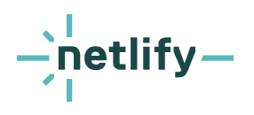

### Hi there 👋

## ⚡ Top Languages:

## 🧰 Languages and Tools:

<!--  -->

<!--  -->

## 📫 How to reach me: 

https://www.linkedin.com/in/jessica-stephens-784b88166/

<!--
**jstephensdev/jstephensdev** is a ✨ _special_ ✨ repository because its `README.md` (this file) appears on your GitHub profile.

Here are some ideas to get you started:

- 🔭 I’m currently working on improving my React and Vue skills.
- 🌱 I’m currently learning to dockerize applications and python promgraming.
- 👯 I’m looking to collaborate on ...
- 🤔 I’m looking for help with ...
- 💬 Ask me about ...
- 📫 How to reach me: https://www.linkedin.com/in/jessica-stephens-784b88166/
- 😄 Pronouns: ...
- ⚡ Fun fact: ...
-->
